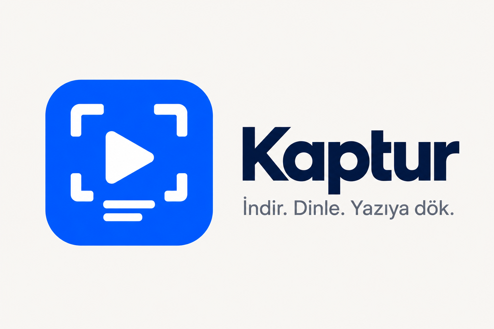

# Kaptur (prototip)



> Eski adı ReelGrab. İlk açılışta `%LOCALAPPDATA%\ReelGrab` verileri `%LOCALAPPDATA%\Kaptur` klasörüne taşınır.

Windows tepsisinde çalışan küçük bir uygulama. Instagram, X (Twitter) ve YouTube linklerindeki videoları indirir, isterseniz
faster-whisper ile `.txt` ve `.srt` transcript çıkarır. [mc-download-manager](https://github.com/mstcvk/mc-download-manager)'ın
macOS'taki yt-dlp yaklaşımı örnek alınarak .NET (WinForms) ile yazıldı.

## Kullanım

- **Link yapıştır:** Pencereye Instagram/X linkini yapıştırıp *İndir*'e basın; pencere odaktayken metin kutusu dışında Ctrl+V de olur.
  Elle yapıştırmada yt-dlp'nin desteklediği her site (TikTok, YouTube…) çalışır.
- **Pano izleme:** Herhangi bir yerde Instagram/X linki kopyaladığınızda bildirim çıkar, tıklayınca indirilir.
  Ayarlar'dan "sormadan hemen indir" seçilebilir.
- **Transcript:** "Transcript de çıkar" işaretliyse video indikten sonra yanına aynı adla `.txt` ve `.srt` yazılır
  (`.srt` aynı addaki videoyla oynatıcılarda altyazı olarak açılır). İndirilmiş bir iş için sağ tık > *Transcript çıkar*.
  Bir video/ses dosyasını pencereye sürükleyip yalnızca transcript de çıkarabilirsiniz.
- Pencereyi kapatmak uygulamayı kapatmaz. Çıkmak için tepsi simgesine sağ tıklayın.

## Chrome eklentisi

Eklenti, Chrome'daki oturumunuzun çerezlerini kendisi gönderir. Böylece giriş isteyen Instagram reels'leri için
ayrıca çerez ayarı gerekmez. Edge ve Brave'de de çalışır.

- **Araç çubuğu simgesi:** Bir Instagram reel'i ya da X gönderisi açıkken *İndir* veya *İndir + transcript*. Pencerede son
  işler, ilerleme çubuğu ve *Videoyu aç / Klasör / Metni aç / Transcript çıkar / İptal / Tekrar dene* düğmeleri var.
- **Sağ tık menüsü:** Bir linke, videoya ya da sayfaya sağ tıklayıp *Kaptur ile indir* (veya *+ transcript*).
  X ve Instagram akışında videonun üstüne sağ tıklamak yeterli: eklenti o gönderinin kalıcı linkini kendisi bulur.
- **Rozet:** İndirme sürerken simgede yüzde (pembe), transcript sırasında mor, bitince ✓ (hata olursa !).
- **Otomatik başlatma:** Kaptur kapalıysa eklenti onu native messaging ile tepside başlatır.

**Kurulum** (Web Store'da yayınlanana kadar): Kaptur'u bir kez açın, sonra *Araçlar ▾ > Chrome eklentisini kur…*.
Uygulama `chrome://extensions` adresini panoya koyar ve eklenti klasörünü (`%LOCALAPPDATA%\Kaptur\ChromeExtension`) açar:
Geliştirici modu > Paketlenmemiş öğe yükle > bu klasör.

**Nasıl bağlanıyor:**

- **Köprü:** Eklenti, Kaptur'un yalnızca `127.0.0.1:48214` üzerinde açtığı küçük bir HTTP köprüsüne istek gönderir.
  Köprü üç şeyi denetler: Host başlığı yerel olmalı (DNS rebinding'e karşı), Origin bizim eklenti kimliği
  (`hjigcpdeclnpobinaoklbjnfmkhangka`) olmalı ve `X-Kaptur-Extension` başlığı bulunmalı. Bu yüzden sıradan web sayfaları köprüyü kullanamaz.
  Kimlik, manifest'teki `key` sayesinde eklenti hangi klasörden yüklenirse yüklensin aynıdır.
- **Çerezler:** İndirme süresince geçici bir `cookies.txt`'ye yazılır, indirme bitince ya da iptal edilince silinir.
- **Uygulamayı başlatma:** Native messaging host'u, `Kaptur.exe`'nin kendisidir. Chrome onu `chrome-extension://…` argümanıyla
  çağırınca pencere açmadan uygulamayı başlatır. Kaydı her açılışta yalnızca `HKCU` altına yazılır
  (Chrome, Edge, Brave, Chromium); yönetici izni gerekmez. Exe taşınırsa bir kez açmanız yeterli.
- **Köprüyü kapatma:** *Ayarlar > Tarayıcı eklentisi* kutusunun işareti kaldırılırsa köprü kapanır.

## İlk çalıştırmada indirilenler

Hepsi `%LOCALAPPDATA%\Kaptur\tools` altına gider, sisteme bir şey kurulmaz. Silerseniz ihtiyaç anında yeniden iner.

| Ne | Ne zaman | Boyut |
|---|---|---|
| yt-dlp.exe, ffmpeg (yt-dlp/FFmpeg-Builds) | ilk indirmede | ~17 MB + ~190 MB zip |
| uv + Python 3.12 + faster-whisper | ilk transcriptte | ~150 MB |
| CUDA kütüphaneleri (cuBLAS, cuDNN) | ilk transcriptte, NVIDIA GPU varsa | ~1,5 GB |
| Whisper modeli (varsayılan large-v3-turbo) | modelin ilk kullanımında | ~1,6 GB |

GPU'da çalışamazsa (ör. CUDA DLL'i eksikse) transcript otomatik olarak CPU ile yeniden denenir. CPU için *small* modeli önerilir.

## Instagram ve çerezler

Herkese açık reels'lerin bir kısmı girişsiz iner, ama Instagram çoğu zaman giriş ister ya da sık istekte hız sınırına takar.
O durumda *Ayarlar > Çerez kaynağı*:

- **Firefox:** Firefox'ta Instagram'a giriş yapın. Hata alırsanız Firefox'u kapatıp tekrar deneyin, çünkü açık tarayıcı çerez veritabanını kilitleyebilir.
- **cookies.txt:** Bir "cookies.txt" dışa aktarma eklentisiyle Netscape biçiminde alın. Bu dosya hesabınıza erişim sağlar, kimseyle paylaşmayın.

Chrome ve Edge çerezlerini uygulamaya bağlı şifrelemeyle sakladığı için yt-dlp onları doğrudan okuyamaz.

## Derleme

.NET 10 SDK gerekir.

```bash
dotnet build Kaptur/Kaptur.csproj -c Release
```

Çıktı: `Kaptur/bin/Release/net10.0-windows/Kaptur.exe`. Tek dosya halinde paketlemek için (nuget.org erişimi gerekir):

```bash
dotnet publish Kaptur/Kaptur.csproj -c Release -r win-x64 --self-contained false -p:PublishSingleFile=true
```

Geliştirme için arayüzsüz denemeler (çıktı `%LOCALAPPDATA%\Kaptur\kaptur.log`):

```bash
Kaptur.exe --selftest https://x.com/<kullanıcı>/status/<id> --transcribe
```

## Yapı

| Dosya | Görev |
|---|---|
| `Core/Downloader.cs` | yt-dlp çağrısı. `--progress-template` ve `--print` satırlarını ayrıştırır, hatalara Türkçe ipucu ekler |
| `Core/Transcriber.cs`, `Assets/transcribe.py` | uv ile Python ortamını kurar, faster-whisper'ı çalıştırır, GPU'da olmazsa CPU'ya düşer |
| `Core/ToolManager.cs` | yt-dlp, ffmpeg ve uv'yi resmi GitHub sürümlerinden indirir (PATH'te varsa onları kullanır) |
| `Core/JobManager.cs` | Kuyruk: en fazla 2 paralel indirme, aynı anda tek transcript |
| `Core/Bridge.cs` | Eklentinin konuştuğu yerel HTTP köprüsü (`/ping`, `/jobs`, `/download`, `/action`, `/show`) |
| `Core/ChromeIntegration.cs`, `Core/NativeHost.cs` | Eklenti klasörü, native messaging host kaydı ve uygulamayı başlatan host modu |
| `Extension/` | Chrome eklentisi (MV3): arka plan servisi, açılır pencere, X/Instagram için içerik betiği |
| `UI/TrayContext.cs` | Tepsi simgesi, pano izleme, bildirimler |
| `UI/MainForm.cs`, `UI/SettingsForm.cs` | Pencereler |

## Sonraki adımlar

- Eklentiye sayfadaki `.m3u8` / `.mpd` akışlarını yakalama (yt-dlp'nin tanımadığı siteler için).
- Normal dosyalar için parçalı (HTTP Range) indirme motoru, duraklat/sürdür ve tarayıcı indirmelerini yakalama.
- Eklentiyi Chrome Web Store'a koymak (o zaman mağazanın verdiği kimlik `ExtraExtensionIds` ayarına eklenmeli).

Yalnızca hakkınız olan ya da kişisel kullanım için içerik indirin. Platformların kullanım şartları otomatik indirmeyi kısıtlayabilir.
