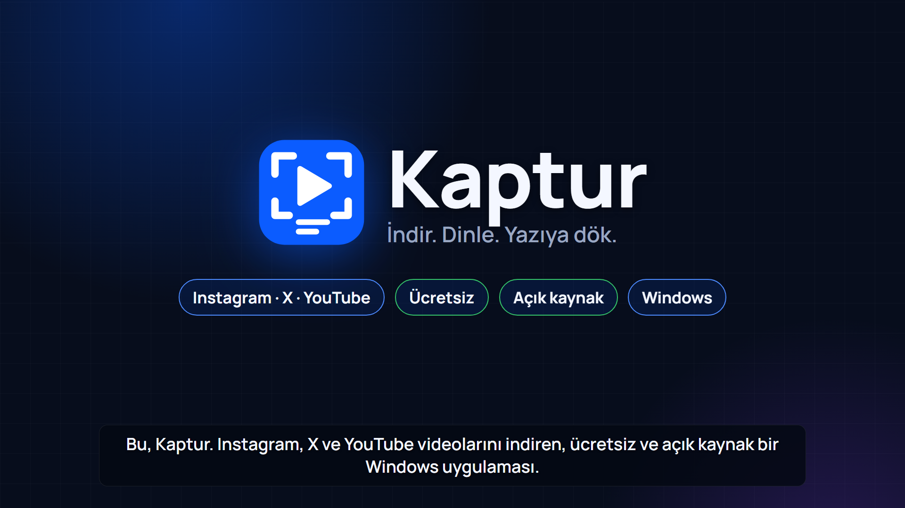
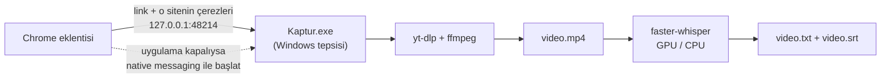

<p align="center">
  
</p>

<p align="center">
  <b>Instagram ve X videolarını tek tıkla indir, istersen konuşmayı yazıya dök.</b><br>
  Windows için ücretsiz ve açık kaynak. Transcript, kendi ekran kartında çalışır: bulut yok, hesap yok, abonelik yok.
</p>

<p align="center">
  <a href="docs/kaptur-tanitim.mp4"></a><br>
  <sub>▶ <a href="docs/kaptur-tanitim.mp4">1 dakikalık tanıtım videosu</a></sub>
</p>

---

## Neler yapıyor?

- **Tek tıkla indirme.** Bir Instagram reel'i ya da X gönderisi açıkken Chrome'daki Kaptur simgesine tıklayın: *İndir* veya *İndir + transcript*.
- **Akıştan sağ tıkla.** X veya Instagram akışında videonun üstüne sağ tıklayıp *Kaptur ile indir*. Eklenti gönderinin linkini kendisi bulur.
- **Konuşmayı yazıya dökme.** [faster-whisper](https://github.com/SYSTRAN/faster-whisper) ile `.txt` ve `.srt` (altyazı) dosyaları videonun yanına kaydedilir. NVIDIA ekran kartı varsa GPU'da saniyeler sürer, yoksa CPU'da çalışır. Türkçe dahil dili kendisi algılar.
- **Instagram oturumu hazır.** Eklenti, Chrome'daki oturumunuzun çerezlerini indirme anında gönderir. Giriş isteyen reels için ayrıca ayar gerekmez. Çerezler yalnızca o indirme için geçici bir dosyaya yazılır ve indirme bitince silinir.
- **Link kopyalamak yeter.** Herhangi bir yerde Instagram/X linki kopyaladığınızda bildirim çıkar, tıklayınca iner.
- **Sürükle-bırak transcript.** Bilgisayarınızdaki bir video ya da ses dosyasını pencereye bırakıp yalnızca transcript alın.
- **Tepside yaşar.** Uygulama kapalıysa eklenti onu kendisi başlatır. İndirme ilerlemesi araç çubuğu simgesinde görünür.
- **Başka siteler de çalışır.** Linki elle yapıştırırsanız [yt-dlp](https://github.com/yt-dlp/yt-dlp)'nin desteklediği her site (YouTube, TikTok…) iner.

## Kurulum

1. [Sürümler](../../releases) sayfasından `Kaptur-win-x64.zip` dosyasını indirip bir klasöre açın ve `Kaptur.exe`'yi çalıştırın.
   [.NET 10 Desktop Runtime](https://dotnet.microsoft.com/download/dotnet/10.0) gerekir.
2. **Chrome eklentisi:** Kaptur penceresinde *Araçlar ▾ > Chrome eklentisini kur…*, ya da:
   `chrome://extensions` > sağ üstte *Geliştirici modu* > *Paketlenmemiş öğe yükle* > Kaptur klasöründeki `Extension`.
   Edge ve Brave'de de aynı şekilde çalışır.
3. İlk indirmede yt-dlp ve ffmpeg, ilk transcriptte Python + faster-whisper ve model kendiliğinden iner
   (hepsi `%LOCALAPPDATA%\Kaptur\tools` altına; sisteme hiçbir şey kurulmaz).

## Nasıl çalışıyor?



- **Uygulama** (.NET 10, WinForms): indirme kuyruğu, pano izleme, tepsi simgesi. Ağır işi açık kaynak araçlar yapar:
  video için yt-dlp + ffmpeg, transcript için faster-whisper. Python'u [uv](https://github.com/astral-sh/uv) uygulamanın kendi klasörüne kurar.
- **Yerel köprü:** Eklenti yalnızca `127.0.0.1` üzerindeki küçük bir HTTP köprüsüyle konuşur. Köprü üç şeyi denetler:
  - Host başlığı yerel olmalı (DNS rebinding'e karşı),
  - Origin bu eklentinin sabit kimliği olmalı,
  - eklentiye özel bir başlık bulunmalı.

  Sıradan web sayfaları köprüyü kullanamaz.
- **Native messaging:** Uygulama kapalıyken eklentinin onu başlatabilmesi için `Kaptur.exe` kendini yalnızca `HKCU` altına kaydeder; yönetici izni gerekmez.

Geliştirici ayrıntıları (derleme, test modları, dosya yapısı): [Kaptur/README.md](Kaptur/README.md).

## Kaynaktan derleme

```bash
dotnet build Kaptur/Kaptur.csproj -c Release
```

## Gizlilik

Kaptur bir sunucuya bağlanmaz ve hesap istemez. Yalnızca şunlar internete çıkar:
- indirdiğiniz videonun kendisi,
- ilk kullanımda indirilen araçlar (GitHub'daki resmî sürümler) ve Whisper modeli (Hugging Face).

Transcript tamamen bilgisayarınızda üretilir.

## Yasal not

Yalnızca hakkınız olan ya da kişisel kullanım için içerik indirin. Instagram ve X'in kullanım şartları otomatik indirmeyi kısıtlayabilir.
Kaptur'un Meta, Instagram, X Corp. ya da Google ile bir bağlantısı yoktur.

## Teşekkürler

- Fikir ve köprü tasarımı, macOS için yazılmış [mc-download-manager](https://github.com/mstcvk/mc-download-manager)'dan ilham aldı.
- [yt-dlp](https://github.com/yt-dlp/yt-dlp), [FFmpeg](https://ffmpeg.org), [faster-whisper](https://github.com/SYSTRAN/faster-whisper), [uv](https://github.com/astral-sh/uv).

## Lisans

[MIT](LICENSE). İlk kullanımda indirilen araçlar kendi lisanslarına tabidir (yt-dlp: Unlicense, FFmpeg derlemesi: GPL, faster-whisper: MIT).
